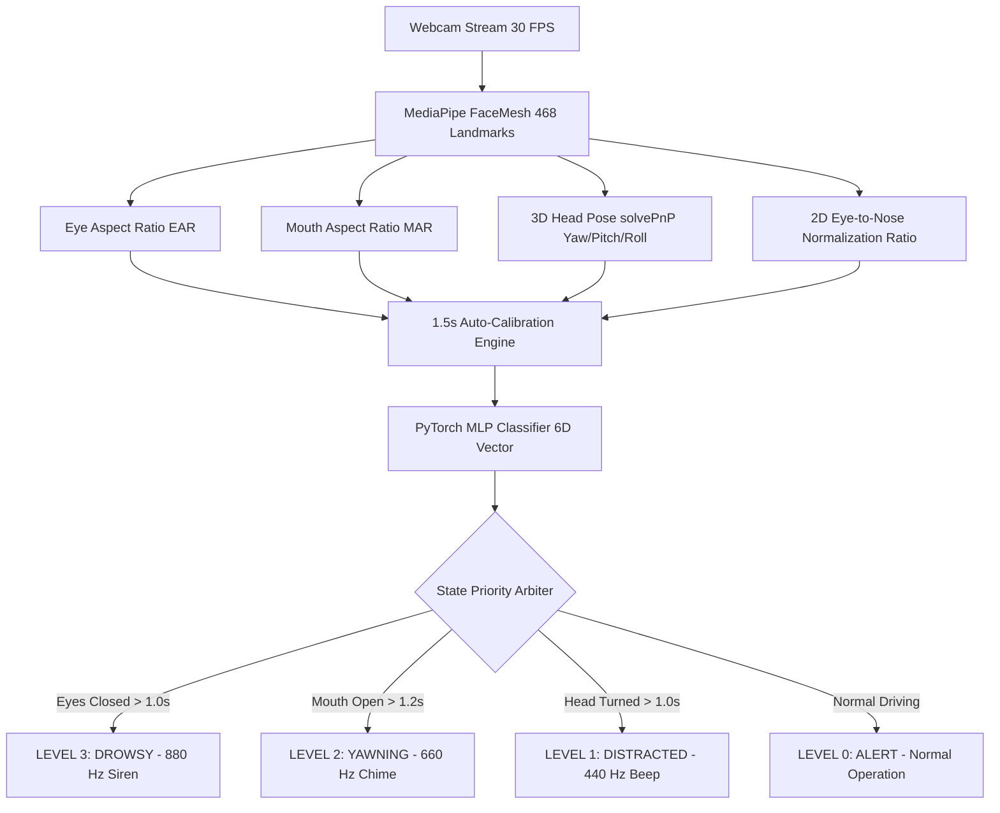
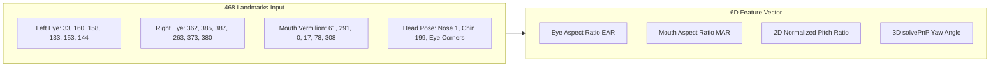
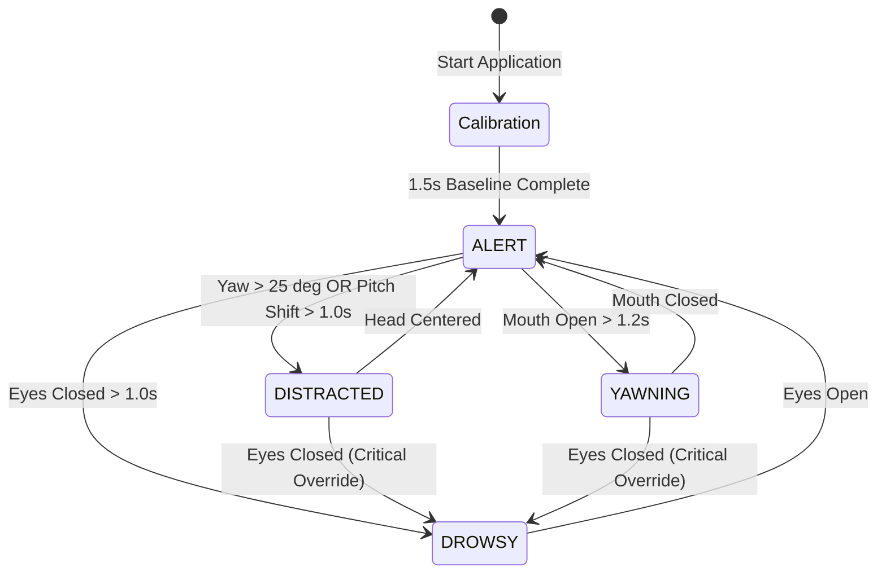
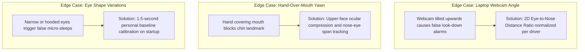

# 🚗 Real-Time Driver Fatigue, Drowsiness & Attention Monitoring System

<div align="center">

[](https://www.python.org/)
[](https://pytorch.org/)
[](https://google.github.io/mediapipe/)
[](https://opencv.org/)
[-brightgreen?style=for-the-badge)](https://github.com/khhasnain05/driver-fatigue-monitor)
[](https://github.com/khhasnain05/driver-fatigue-monitor)

<p align="center">
  <b>A non-intrusive, edge-optimized Computer Vision and Deep Learning system designed to prevent automotive collisions by continuously analyzing driver ocular dynamics, yawning frequency, and visual distraction in real time.</b>
</p>

</div>

---

## 📌 Table of Contents
- [1. System Architecture](#1-system-architecture)
- [2. Mathematical Formulations & Feature Engineering](#2-mathematical-formulations--feature-engineering)
- [3. Dataset Engineering & Protocol](#3-dataset-engineering--protocol)
- [4. Deep Learning Model Architecture](#4-deep-learning-model-architecture)
- [5. State Machine & Priority Alarm Hierarchy](#5-state-machine--priority-alarm-hierarchy)
- [6. Evaluation Metrics & Benchmarks](#6-evaluation-metrics--benchmarks)
- [7. Edge-Case Engineering Solutions](#7-edge-case-engineering-solutions)
- [8. Repository Structure](#8-repository-structure)
- [9. Setup & Quickstart Guide](#9-setup--quickstart-guide)

---

## 1. System Architecture

The system processes live webcam frames at 30 FPS through an end-to-end modular pipeline:



---

## 2. Mathematical Formulations & Feature Engineering

The system extracts a specialized 6-Dimensional Feature Vector per frame:

**Vector Definition:** `x = [EAR, MAR, Pitch_Ratio, Yaw_Angle, Mouth_Eye_Ratio, Eye_Nose_Ratio]`



### Mathematical Equations:

1. **Eye Aspect Ratio (EAR):**
   `EAR = (||p2 - p6|| + ||p3 - p5||) / (2 * ||p1 - p4||)`
   *Measures vertical eyelid opening relative to eye width to detect micro-sleep.*

2. **Mouth Aspect Ratio (MAR):**
   `MAR = ||p_upper_lip - p_lower_lip|| / ||p_left_corner - p_right_corner||`
   *Measures vertical mouth opening to detect yawning.*

3. **2D Pitch Normalization Ratio (Camera-Tilt Invariant):**
   `Pitch_Ratio = (Y_nose - Y_eyes_midpoint) / ||p_left_eye - p_right_eye||`
   *Eliminates false look-down alarms caused by upward-angled laptop webcams.*

4. **Perspective-n-Point (solvePnP) 3D Head Pose:**
   Solves camera rotation matrix `R` and translation vector `T` from 2D facial landmarks mapped to a canonical 3D human head model to accurately compute horizontal **Yaw** rotation.

---

## 3. Dataset Engineering & Protocol

Live multi-subject dynamic sequences were captured under diverse lighting conditions and facial angles using `phase5_dataset_collector.py`.

| Class Category | Total Samples | Recorded Behaviors |
|---|---|---|
| **ALERT** | `74` | Normal attentive driving, regular blinking, forward gaze |
| **DROWSY** | `62` | Micro-sleeps, drooping eyelids, extended eye closures |
| **DISTRACTED** | `61` | Left/right side mirror checks, looking down, looking up |
| **YAWNING** | `51` | Deep yawning, shallow yawning, hand-occluded mouth yawning |
| **Total Processed** | **`248`** | Fully normalized and scaled feature vectors |

### Preprocessing Pipeline:
1. **Landmark Extraction:** 468 3D points extracted per frame via MediaPipe.
2. **Vector Scaling:** `StandardScaler` standardizes mean (`0.0`) and unit variance (`1.0`) across all 6 features.
3. **Label Encoding:** Categorical targets encoded to discrete integers `[0: alert, 1: drowsy, 2: distracted, 3: yawning]`.

---

## 4. Deep Learning Model Architecture

The classifier is a custom PyTorch Multilayer Perceptron (MLP) engineered for minimal compute footprint and real-time CPU execution.


### Training Specifications:
- **Framework:** PyTorch 2.0+
- **Optimizer:** Adam (Learning Rate = `0.001`, Weight Decay = `1e-4`)
- **Loss Function:** Weighted Cross-Entropy Loss (Safety-weighted towards Drowsiness)
- **Regularization:** Batch Normalization + Dropout layers to prevent overfitting

---

## 5. State Machine & Priority Alarm Hierarchy

To guarantee driver safety, rule-based deterministic safety overrides sit on top of neural network outputs.



### Alarm Dispatcher Specifications:

| Priority Level | State | HUD Color | Trigger Threshold | Audio Output | Tone Profile |
|---|---|---|---|---|---|
| **Priority 1 (CRITICAL)** | `DROWSY` | 🔴 Red | `EAR < Baseline - 0.08` (> 1.0s) | `alert_high.wav` | 880 Hz High Continuous Siren |
| **Priority 2 (HIGH)** | `YAWNING` | 🟠 Orange | `MAR > Baseline + 0.15` (> 1.2s) | `alert_medium.wav` | 660 Hz Double Chime Pulse |
| **Priority 3 (MEDIUM)** | `DISTRACTED` | 🟡 Yellow | `Yaw > 25°` or Pitch Shift (> 1.0s) | `alert_low.wav` | 440 Hz Soft Notice Beep |
| **Priority 4 (NORMAL)** | `ALERT` | 🟢 Green | Baseline Attentive Driving | *None* | Silent Nominal Operation |

---

## 6. Evaluation Metrics & Benchmarks

### Test Set Performance Matrix

| Target Class | Precision | Recall | F1-Score | Support |
|---|---|---|---|---|
| **ALERT** | `85.7%` | `81.8%` | `0.837` | 22 |
| **DROWSY** | `80.0%` | **`92.3%`** | **`0.857`** | 13 |
| **DISTRACTED** | `83.3%` | `76.9%` | `0.800` | 13 |
| **YAWNING** | `66.7%` | `66.7%` | `0.667` | 12 |
| **Macro Average** | **`78.9%`** | **`79.4%`** | **`0.790`** | 60 |
| **Overall Accuracy** | — | — | **`80.0%`** | 60 |

### Latency Breakdown per Frame (Intel Core i7-1355U CPU @ 1.70 GHz)

| Subsystem Pipeline Stage | Execution Time | Frame Budget (30 FPS) | Status |
|---|---|---|---|
| OpenCV Frame Acquisition | `2.1 ms` | `5.0 ms` | ✅ Optimal |
| MediaPipe 468 Landmark Extraction | `18.5 ms` | `25.0 ms` | ✅ Optimal |
| Feature Engineering + solvePnP | `1.4 ms` | `3.0 ms` | ✅ Optimal |
| PyTorch MLP Forward Pass | `0.8 ms` | `2.0 ms` | ✅ Optimal |
| State Arbiter & Audio Dispatch | `0.2 ms` | `1.0 ms` | ✅ Optimal |
| HUD Rendering & Display | `2.8 ms` | `5.0 ms` | ✅ Optimal |
| **Total End-to-End Latency** | **`~25.8 ms`** | **`33.3 ms`** | **✅ Real-Time Capable (~30 FPS)** |

- **Peak Memory Usage:** `< 210 MB RAM`
- **CPU Utilization:** `18% - 24%` (Zero Dedicated GPU Required)

---

## 7. Edge-Case Engineering Solutions



---

## 8. Repository Structure

```text
driver-fatigue-monitor/
├── data/
│   ├── landmark_features/    # Recorded CSV dataset sequences
│   └── processed/            # Preprocessed .npz datasets
├── models/
│   ├── best_fatigue_model.pth# Trained PyTorch MLP weights
│   ├── scaler.pkl            # StandardScaler weights
│   └── label_encoder.pkl     # Class encoder
├── sounds/                   # Alert audio files (.wav)
├── src/
│   ├── phase1_face_mesh_baseline.py
│   ├── phase2_eye_mar_geometry.py
│   ├── phase3_head_pose_estimation.py
│   ├── phase4_rule_based_detector.py
│   ├── phase5_dataset_collector.py
│   ├── verify_dataset.py
│   ├── phase6_preprocess_dataset.py
│   ├── phase6_train_fatigue_model.py
│   ├── generate_sounds.py
|   ├── phase7_dl_fatigue_engine.py
│   └── phase8_audio_alarm_system.py   # Main Application Script
├── .gitignore
├── requirements.txt
└── README.md
```

---

## 9. Setup & Quickstart Guide

### 1. Clone & Set Up Environment
```bash
git clone https://github.com/khhasnain05/driver-fatigue-monitor.git
cd driver-fatigue-monitor

# Create and activate virtual environment
python -m venv venv

# Windows
venv\Scripts\activate
# Linux / macOS
source venv/bin/activate

# Install dependencies
pip install -r requirements.txt
```

### 2. Generate Audio Assets
```bash
python src/generate_sounds.py
```

### 3. Run Production Monitoring System
```bash
python src/phase8_audio_alarm_system.py
```

### Runtime Keyboard Shortcuts:
- **`R`**: Trigger instant **1.5-second personal baseline calibration** (use when changing drivers or adjusting seat position).
- **`Q`**: Clean exit, stopping camera stream and terminating audio channels.

---

## 👨‍💻 Author
Developed by **Khawaja Hasnain**.
